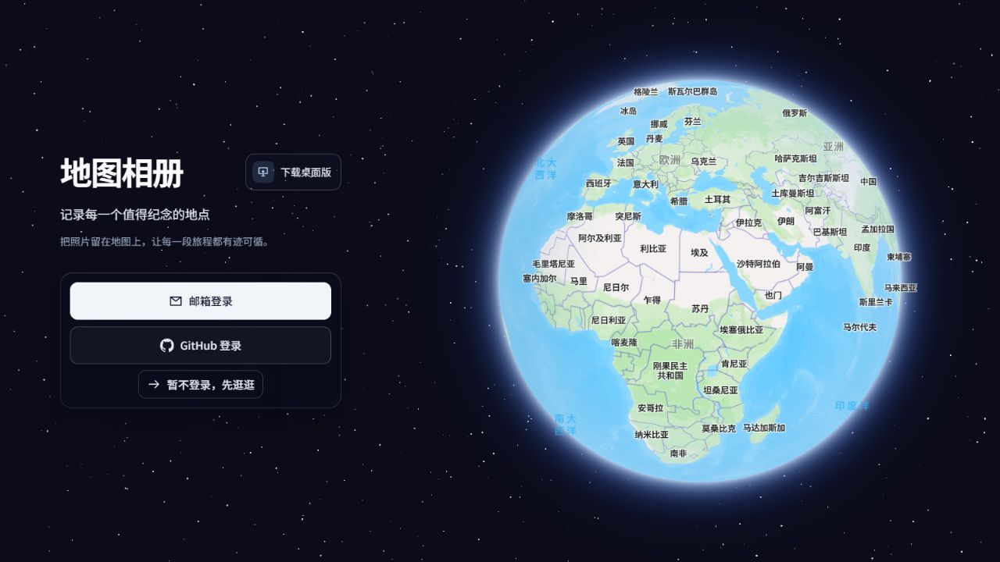
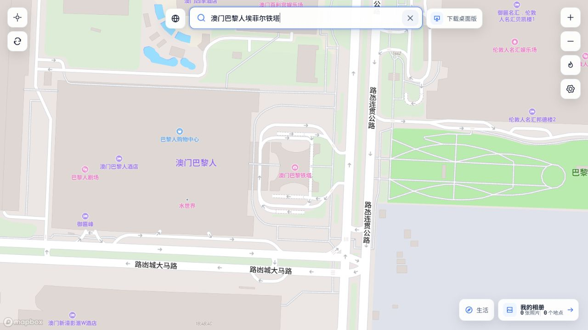

# 地图相册 · PhotoMap

把照片留在地图上，让每一段旅程都有迹可循。

PhotoMap 是一个基于 React、Electron 和 Mapbox 的照片地图项目。你可以在地图上添加地点、上传照片、记录备注，再通过相册、搜索和生活足迹回看自己的记录。项目同时提供桌面版和 Web 版。

## 项目截图

<p align="center">
  
  
</p>

截图使用公开界面，不包含个人照片或私人地点。

## 获取桌面版

在 [GitHub Releases](https://github.com/Satulalala/photo-map/releases/latest) 下载最新版本。Windows x64 提供安装版和免安装版；macOS 提供 Intel 与 Apple 芯片安装包；Linux 提供 AppImage、deb 和 rpm。GitHub Actions 通过仓库 Secret `MAPBOX_TOKEN` 为各平台桌面包注入地图访问令牌；未配置时地图无法加载。macOS 版本目前未签名，首次打开时需在系统安全设置中手动允许。

## 功能

- **地图与地点**：可拖动旋转的地球入口、中文地图标签、地点搜索、定位、缩放、标记与照片热力图。
- **照片与备注**：一个地点关联多张照片，支持预览、旋转、裁剪、备注编辑及批量管理。
- **我的相册**：查看照片与地点数量，通过标记列表跳转到拍摄位置并打开详情。
- **生活足迹**：按国内地区、海外国家整理已有地点记录。
- **语义搜索**：当前暂未开放，不会下载或加载本地嵌入模型；后续再评估服务器端模型服务。
- **账号与同步**：登录后按账号同步地点、照片备注与照片文件；照片存 R2，元数据存 D1，桌面版和 Web 版共用云端数据。
- **界面与交互**：浅色、深色及跟随系统主题，响应式浮层、键盘操作和减少动画支持。

地图默认优先显示中文；未提供中文名称的地点仍可能显示当地语言。进入地图使用设备定位或默认坐标，拖动登录页地球用于浏览，不会改变进入地图的定位目标。

## 桌面版与 Web 版

| 能力 | 桌面版 | Web 版 |
| --- | --- | --- |
| 地图、标记、照片与备注 | 支持 | 支持 |
| 本地存储 | SQLite 与本地照片文件 | 浏览器 IndexedDB |
| 照片旋转、裁剪 | 支持 | 支持 |
| 地名、备注文字搜索 | 支持 | 支持 |
| 语义搜索 | 暂未开放，不加载模型 | 暂未开放 |
| 云端同步 | 登录后同步到 Cloudflare Worker + D1/R2 | 登录后同步到 Cloudflare Worker + D1/R2 |

桌面版保留本机 SQLite 与照片文件，Web 版使用浏览器 IndexedDB；登录后地点和备注同步到 D1，原图与缩略图上传到 R2，并按账号隔离。游客数据不会自动上传，可在设置中导入到登录账户。默认服务为 `https://photomap.satula.top`；选择“暂不登录”仍可使用本地相册。

## MapLibre 测试版

本地 Web 开发时访问 `http://localhost:3001/maplibre-test`。该路由继续使用 PhotoMap 原有登录、会话、页面布局、相册数据和地图业务组件；只有地图渲染引擎切换为 MapLibre，正式首页仍使用 Mapbox。Cloudflare Worker 配置了 SPA fallback，部署包含此版本后也可直接访问 `/maplibre-test`；当前修改不会自动部署生产环境。

测试页读取现有浏览器 IndexedDB 中的地点和照片。为了避免测试内容写入真实相册，地点、照片和设置的 IndexedDB 写事务会被拦截，云同步队列和云端推送/拉取在此路由禁用；认证仍沿用原有账号与 Session。页面会显示“MapLibre 测试 · 数据只读”标识。

默认底图使用 OpenFreeMap Liberty 全球矢量样式（OpenStreetMap 数据），无需 API Key；可通过 `.env` 中的 `VITE_MAPLIBRE_STYLE_URL` 替换为符合项目用途和授权条件的 MapLibre 样式服务。当前地点搜索仍复用既有高德 / Mapbox 地理编码 API。MapLibre 使用透明天空、CSS 星点和 GL JS 大气层样式模拟正式版的星空边缘；Mapbox 专属的 `fog`、`space-color` 和 `star-intensity` 效果无法完全等同。

## 技术栈

| 部分 | 当前实现 |
| --- | --- |
| 前端 | React 18、Vite 8、Zustand、CSS |
| 桌面运行时 | Electron 44、IPC |
| 地图 | Mapbox GL JS 3.32.0（正式版）；MapLibre GL JS 6.13.0（只读测试版） |
| 桌面数据与图像处理 | better-sqlite3、sqlite-vec、Sharp |
| 语义搜索 | 当前关闭；桌面端不下载或加载模型，相关依赖暂留待后续评估 |
| Web 数据 | IndexedDB、LocalStorage |
| 后端 | Web 生产：Cloudflare Workers + D1；桌面/本地：Java 17+、Spring Boot 3.5、JWT、Spring Data JPA |
| 验证工具 | Vitest、Testing Library、Playwright、ESLint、TypeScript |

具体依赖版本以 [package.json](package.json)、[package-lock.json](package-lock.json) 和 [后端 pom.xml](server-java/pom.xml) 为准。

## 本地运行

以下命令均从项目根目录执行，除非另有说明。

### 1. 准备环境

- Node.js：推荐使用 [.nvmrc](.nvmrc) 指定的 **22.23.2**；其他受支持版本见 `package.json` 中的 `engines`。
- npm：10 或以上。
- Java 后端可选：需要 JDK 17+、Maven 3.6.3+。本地地图和相册不要求启动后端，邮箱登录和同步需要后端。

```bash
npm ci
npm run env:check
```

安装过程会下载 Electron，并检查桌面运行时的原生模块。仅开发 Web 时可使用 `npm ci --ignore-scripts`；之后切换到桌面开发，应运行 `npm rebuild` 和 `npm run native:check`。

### 2. 配置地图 Token

复制 [.env.example](.env.example) 为 `.env`，填写自己的 Mapbox 公共访问令牌，已有 `.env` 无需覆盖：

```dotenv
VITE_MAPBOX_TOKEN=你的_Mapbox_公共访问令牌
```

令牌可在 [Mapbox 账号页面](https://account.mapbox.com/access-tokens/) 创建。前端环境变量会进入浏览器代码，因此这里应使用公共令牌。修改后需要重启开发服务器；发布时需要在构建环境中设置该变量。

### 3. 启动应用

桌面版：

```bash
npm run dev
```

Web 版：

```bash
npm run web:dev
```

| 服务 | 默认地址 |
| --- | --- |
| 桌面版 Vite 开发服务 | `http://localhost:3000` |
| Web 版 | `http://localhost:3001` |
| Java 后端 | `http://localhost:8080` |

首次启动桌面版会加载图片搜索模型，下载时间取决于网络。模型未就绪时描述搜索会显示加载提示；首次检索还会补建缺失的照片索引。

### 4. 启动后端（可选）

Windows 推荐使用项目脚本，避免直接执行 `mvn` 时找不到命令：

```powershell
npm run server:dev
npm run server:verify
```

脚本会优先使用 `JAVA_HOME` 和 PATH 中的 Maven，也会尝试查找已有 Windows JDK 与 IntelliJ 内置 Maven。若仍未找到，请安装 JDK / Maven 并配置环境变量。

Linux / macOS 或已配置 Maven 的环境：

```bash
mvn -f server-java/pom.xml spring-boot:run
mvn -f server-java/pom.xml verify
```

开发配置使用 H2 内存数据库。生产配置使用 PostgreSQL，需要在后端进程环境中设置：

```text
SPRING_PROFILES_ACTIVE=prod
PHOTOMAP_DB_URL
PHOTOMAP_DB_USERNAME
PHOTOMAP_DB_PASSWORD
PHOTOMAP_JWT_SECRET
PHOTOMAP_CORS_ALLOWED_ORIGINS
```

取值示例见 `.env.example`。根目录 `.env` 用于前端构建，不会自动注入 Java 后端。生产配置默认校验数据库结构，不会自动创建业务表。

### 部署到 Cloudflare

当前线上站点为 [photomap.satula.top](https://photomap.satula.top)，健康检查为 [`/api/health`](https://photomap.satula.top/api/health)。一个 Cloudflare Worker 同时提供 `dist-web` 静态文件与 `/api/v1` 认证、`/api/v2` 同步接口；D1 持久保存账号和同步元数据，R2 保存按账号隔离的原图与缩略图。

Web 版使用同源 HttpOnly Cookie。打包桌面版通过固定的 `photomap://app` 安全源访问 Cloudflare API；Worker 只允许这个桌面源进行带凭据 CORS，并为其设置 24 小时有效的 `HttpOnly; Secure; SameSite=None` 会话 Cookie。桌面端保留本地照片和 SQLite 数据，同时将登录账户的数据同步到云端。不要把 `JWT_SECRET` 或 Cloudflare API Token 放进前端配置。

1. 使用 Cloudflare CLI 登录，并为自己的部署准备 D1 数据库：

   ```bash
   npx wrangler login
   npx wrangler d1 create photo-map-prod
   ```

   将返回的数据库 ID 与名称填入 `wrangler.jsonc`。本仓库配置指向项目当前线上账户；使用自己的账户时必须替换 D1 ID 和 `routes` 域名。

2. 把 D1 表结构应用到远端数据库：

   ```bash
   npm run cloudflare:migrate
   ```

3. 在 Cloudflare Workers Builds 中连接仓库 `Satulalala/photo-map`，生产分支设为 `master`，并配置公开 Mapbox 访问令牌构建变量 `VITE_MAPBOX_TOKEN`。构建命令使用 `npm ci --ignore-scripts && npm run cloudflare:build`，部署命令使用 `npm run cloudflare:deploy`。如果启用预览部署，应为预览环境单独配置 D1 数据库和域名。

4. 在 Worker 的 **Settings → Variables and Secrets** 设置 `JWT_SECRET`，使用随机生成的至少 32 字节密钥；也可运行 `npx wrangler secret put JWT_SECRET`。不要把该密钥写入 Git、`.env` 或 Wrangler 普通变量。缺少该密钥时 API 会返回 503，不会创建半成品账号。

5. 创建 GitHub OAuth App，将授权回调地址设为 `https://photomap.satula.top/api/v1/auth/github/callback`，并把 `GITHUB_CLIENT_ID` 与 `GITHUB_CLIENT_SECRET` 设为 Worker Secrets。OAuth 只请求 GitHub 用户资料和已验证邮箱权限。

6. 在腾讯云邮件推送香港地域（`ap-hongkong`）验证发信域名 `mail.photomap.satula.top`，创建发信地址 `no-reply@mail.photomap.satula.top`，并上传 `cloudflare/password-reset-template.html`。模板保留固定域名 `https://photomap.satula.top/`，唯一变量 `{{resetToken}}` 仅包含重置令牌，不能将整个 URL 作为变量。将 `TENCENT_SECRET_ID`、`TENCENT_SECRET_KEY` 和 `TENCENT_SES_TEMPLATE_ID` 配置为 Worker Secrets；密钥应使用仅有邮件发送权限的 CAM 子用户凭据。模板审核通过并确认发信地址后，将 `wrangler.jsonc` 中的 `AUTH_EMAIL_ENABLED` 改为 `"true"` 再部署。邮件重置令牌只以哈希形式保存，有效期 30 分钟，使用后会使旧会话失效。

7. 检查 `https://<域名>/api/health`，确认 `ok` 与 `authReady` 为 `true`，然后将自定义域名路由绑定到 Worker。改动 D1 表结构后先运行 `npm run cloudflare:migrate`，再部署 Worker。

Worker 登录使用 PBKDF2-SHA256（100,000 次迭代），并先用只保存在 Worker Secret 中的 `PASSWORD_PEPPER` 做 HMAC-SHA256。Cloudflare 生产运行时的 Web Crypto PBKDF2 迭代上限为 100,000；创建密码后不要轮换 pepper，否则现有密码将无法验证。部署前需用 `wrangler secret put PASSWORD_PEPPER` 设置至少 32 字节的随机值。请关注线上 CPU 用量；若触发 1102 资源限制，应评估 Workers Paid 计划或其他适配方案，不要静默改弱认证保护。[Cloudflare Workers 限额说明](https://developers.cloudflare.com/workers/platform/limits/)

本地联调 Cloudflare Worker 与本地 D1 可运行 `npm run cloudflare:dev`；需要先在被忽略的 `.dev.vars` 中配置本地 `JWT_SECRET`。一般 Web 本地开发仍可运行 `npm run web:dev`，它会把 `/api` 代理到本机 Java 服务。

## 构建与验证

按修改范围选择命令；纯文档修改不需要重新构建应用。

```bash
npm run lint
npm run type-check
npm test
node --test electron/ipc-handlers/ai-handlers.test.cjs
npm run test:e2e
npm run build          # 桌面前端，输出到 build/
npm run web:build      # Web，输出到 dist-web/
npm run dist -- --win --x64 --publish never # Windows x64 安装与免安装包
npm run dist          # 按当前操作系统构建桌面包
```

推送 `v*` 版本标签会触发 `.github/workflows/build-release.yml`，在 Windows、macOS、Linux 构建桌面包并创建 GitHub Release。Windows 文件名以 `-setup.exe`（安装版）和 `-portable.exe`（免安装版）区分。

Playwright 在 Windows 本地会优先使用已安装的 Edge；其他环境可运行 `npx playwright install chromium`，也可通过 `PLAYWRIGHT_CHANNEL` 指定浏览器。UI 测试会隔离地图外部接口，真实底图加载仍需有效 Token 和网络。

## 目录结构

```text
PhotoMap/
├─ electron/              # 桌面主进程、SQLite、IPC 与图片搜索
├─ src/
│  ├─ api/                # 统一接口、浏览器存储与同步
│  ├─ components/         # 地图、相册、生活与设置 UI
│  ├─ hooks/              # 地图、登录、搜索及交互逻辑
│  ├─ store/              # Zustand 状态
│  └─ styles/             # 组件样式与布局
├─ src-web/               # Web 入口与适配
├─ server-java/           # Spring Boot 后端
├─ scripts/               # 启动、环境检查和 UI 截图工具
├─ e2e/                   # Playwright UI 测试
├─ .github/workflows/     # 自动构建与发布配置
├─ AGENTS.md              # 项目协作规则
└─ .env.example           # 环境变量示例
```

## 当前限制

- 语义搜索目前关闭，桌面端不会下载或加载嵌入模型；地名、地点名称和备注文本搜索可正常使用。
- Cloudflare 同步上传地点和备注等元数据到 D1，并上传原图与缩略图到 R2；每个账户有 5 GiB 云端存储配额。已有游客数据需要手动导入账户。
- 后端的 `/api/v1/ai/search`、`ask`、`summarize` 使用文本匹配、规则和统计生成结果，尚未接入大语言模型；语义照片搜索当前关闭。
- Cloudflare Web 部署将 API 与页面放在同一域名；上线前需要创建 D1、设置 `JWT_SECRET` 和 Mapbox 公共令牌。已有 Java/PostgreSQL 账号不会自动迁移到新的 D1 数据库。
- 地图使用 Mapbox 的数据和网络服务，加载速度与数据时效取决于服务及连接情况。当前使用原生视口缓存与进入地图前预加载，不提供完整离线地图。
- 本地照片、数据库、模型缓存、个人权限配置与测试截图不纳入 Git；README 中的项目截图不包含个人数据。Web 本地副本随浏览器站点数据保存，清除站点数据会影响本地相册。

## License

[MIT](LICENSE)

---

# English

# PhotoMap: A Photo Album on the Map

Keep your photos on the map, so every journey leaves a trace.

PhotoMap is a photo-mapping app built with React, Electron, and Mapbox. Add places to a map, upload photos, write notes, and revisit your records through albums, search, and travel history. The project provides both desktop and web versions.

## Screenshots

<p align="center">
  
  
</p>

The screenshots show public-facing screens and contain no personal photos or private locations.

## Download the Desktop App

Download the latest release from [GitHub Releases](https://github.com/Satulalala/photo-map/releases/latest). Windows x64 provides installer and portable packages; macOS provides packages for Intel and Apple silicon; Linux provides AppImage, deb, and rpm packages. GitHub Actions injects the map access token into desktop packages for each platform through the repository Secret `MAPBOX_TOKEN`. The map cannot load without it. The macOS version is currently unsigned, so you may need to allow it manually in System Settings the first time you open it.

## Features

- **Map and places:** A rotatable globe entry screen, Chinese map labels, place search, geolocation, zoom, markers, and a photo heatmap.
- **Photos and notes:** Associate multiple photos with a place; preview, rotate, and crop photos; edit notes; and manage items in batches.
- **My Album:** View photo and place counts, jump to a shooting location from the marker list, and open its details.
- **Travel history:** Organize existing place records by regions in China and by country elsewhere.
- **Semantic search:** Currently unavailable. The app does not download or load a local embedding model; a server-side model service may be evaluated later.
- **Accounts and sync:** After signing in, places, photo notes, and photo files sync by account. Photos are stored in R2 and metadata in D1; desktop and web clients share the same cloud data.
- **Interface and interaction:** Light, dark, and system themes; responsive overlays; keyboard support; and reduced-motion support.

The map prioritizes Chinese labels. Places without Chinese names may still appear in their local language. The map uses the device location or a default coordinate when opened. Dragging the globe on the sign-in page is for browsing and does not change the map's location target.

## Desktop and Web Versions

| Capability | Desktop | Web |
| --- | --- | --- |
| Map, markers, photos, and notes | Supported | Supported |
| Local storage | SQLite and local photo files | Browser IndexedDB |
| Rotate and crop photos | Supported | Supported |
| Search place names and note text | Supported | Supported |
| Semantic search | Not available; no model is loaded | Not available |
| Cloud sync | Sign in to sync through Cloudflare Worker + D1/R2 | Sign in to sync through Cloudflare Worker + D1/R2 |

The desktop version keeps its SQLite database and photo files on the device. The web version uses browser IndexedDB. After sign-in, places and notes sync to D1, while originals and thumbnails are uploaded to R2 and isolated by account. Guest data is not uploaded automatically; you can import it into a signed-in account in Settings. The default service is `https://photomap.satula.top`. Choose “Not now” at sign-in to continue using the local album.

## MapLibre Test Version

During local web development, open `http://localhost:3001/maplibre-test`. This route continues to use PhotoMap's existing sign-in, session, page layout, album data, and map business components; only the map rendering engine switches to MapLibre. The production home page still uses Mapbox. The Cloudflare Worker has an SPA fallback, so `/maplibre-test` can also be opened directly when this version is included in a deployment. Current changes do not deploy to production automatically.

The test page reads places and photos from the existing browser IndexedDB. To keep test content out of the real album, IndexedDB write transactions for places, photos, and settings are intercepted, and the cloud sync queue plus cloud push/pull are disabled on this route. Authentication still uses the existing account and session. The page displays a “MapLibre Test · Read-only Data” label.

The default basemap uses the OpenFreeMap Liberty global vector style (OpenStreetMap data) and requires no API key. You can replace it with a MapLibre style service that fits the project's use and licensing terms through `VITE_MAPLIBRE_STYLE_URL` in `.env`. Place search still reuses the existing Amap / Mapbox geocoding APIs. MapLibre uses a transparent sky, CSS stars, and GL JS atmosphere styling to approximate the starry edge of the production map. It cannot fully reproduce Mapbox-only `fog`, `space-color`, and `star-intensity` effects.

## Tech Stack

| Area | Current implementation |
| --- | --- |
| Frontend | React 18, Vite 8, Zustand, CSS |
| Desktop runtime | Electron 44, IPC |
| Maps | Mapbox GL JS 3.32.0 (production); MapLibre GL JS 6.13.0 (read-only test version) |
| Desktop data and image processing | better-sqlite3, sqlite-vec, Sharp |
| Semantic search | Currently disabled; the desktop app does not download or load a model, and related dependencies are retained for later evaluation |
| Web data | IndexedDB, LocalStorage |
| Backend | Web production: Cloudflare Workers + D1; desktop/local: Java 17+, Spring Boot 3.5, JWT, Spring Data JPA |
| Verification tools | Vitest, Testing Library, Playwright, ESLint, TypeScript |

See [package.json](package.json), [package-lock.json](package-lock.json), and the [backend pom.xml](server-java/pom.xml) for exact dependency versions.

## Run Locally

Run the following commands from the project root unless noted otherwise.

### 1. Prepare the Environment

- Node.js: **22.23.2**, as specified by [.nvmrc](.nvmrc), is recommended. See `engines` in `package.json` for other supported versions.
- npm: version 10 or later.
- Optional Java backend: JDK 17+ and Maven 3.6.3+. The local map and album do not require the backend; email sign-in and sync do.

```bash
npm ci
npm run env:check
```

Installation downloads Electron and checks native modules for the desktop runtime. For web-only development, you can use `npm ci --ignore-scripts`. Before switching to desktop development, run `npm rebuild` and `npm run native:check`.

### 2. Configure a Map Token

Copy [.env.example](.env.example) to `.env` and enter your own public Mapbox access token. Do not overwrite an existing `.env`:

```dotenv
VITE_MAPBOX_TOKEN=your_public_Mapbox_access_token
```

Create a token on the [Mapbox account page](https://account.mapbox.com/access-tokens/). Frontend environment variables are included in browser code, so use a public token here. Restart the development server after changing it. Set the variable in the build environment when publishing.

### 3. Start the App

Desktop:

```bash
npm run dev
```

Web:

```bash
npm run web:dev
```

| Service | Default address |
| --- | --- |
| Desktop Vite development server | `http://localhost:3000` |
| Web version | `http://localhost:3001` |
| Java backend | `http://localhost:8080` |

On the first desktop launch, the app loads the image-search model; download time depends on the network. Until the model is ready, description search displays a loading message. The first search also creates any missing photo indexes.

### 4. Start the Backend (Optional)

On Windows, use the project scripts to avoid errors when `mvn` is not directly available:

```powershell
npm run server:dev
npm run server:verify
```

The scripts first check `JAVA_HOME` and Maven on PATH, then look for an installed Windows JDK and IntelliJ's bundled Maven. If neither is found, install JDK / Maven and configure the environment variables.

On Linux / macOS, or in an environment where Maven is configured:

```bash
mvn -f server-java/pom.xml spring-boot:run
mvn -f server-java/pom.xml verify
```

Development uses an H2 in-memory database. Production uses PostgreSQL and requires these variables in the backend process environment:

```text
SPRING_PROFILES_ACTIVE=prod
PHOTOMAP_DB_URL
PHOTOMAP_DB_USERNAME
PHOTOMAP_DB_PASSWORD
PHOTOMAP_JWT_SECRET
PHOTOMAP_CORS_ALLOWED_ORIGINS
```

Example values are in `.env.example`. The root `.env` is used for frontend builds and is not automatically passed to the Java backend. Production validates the database schema by default and does not create business tables automatically.

### Deploy to Cloudflare

The current live site is [photomap.satula.top](https://photomap.satula.top), with a health check at `/api/health`. One Cloudflare Worker serves both the `dist-web` static files and the `/api/v1` authentication and `/api/v2` sync APIs. D1 persistently stores accounts and sync metadata; R2 stores originals and thumbnails isolated by account.

The web version uses same-origin HttpOnly cookies. The packaged desktop app accesses the Cloudflare API through the fixed secure origin `photomap://app`. The Worker allows credentialed CORS only for this desktop origin and sets a 24-hour `HttpOnly; Secure; SameSite=None` session cookie. The desktop app keeps local photos and SQLite data while syncing signed-in account data to the cloud. Never put `JWT_SECRET` or a Cloudflare API token in frontend configuration.

1. Log in with the Cloudflare CLI and create a D1 database for your deployment:

   ```bash
   npx wrangler login
   npx wrangler d1 create photo-map-prod
   ```

   Put the returned database ID and name in `wrangler.jsonc`. The repository configuration points to the account currently used by the project; for your own account, replace the D1 ID and the `routes` domain.

2. Apply the D1 schema to the remote database:

   ```bash
   npm run cloudflare:migrate
   ```

3. Connect the `Satulalala/photo-map` repository in Cloudflare Workers Builds, set the production branch to `master`, and configure the public Mapbox access token as the build variable `VITE_MAPBOX_TOKEN`. Use `npm ci --ignore-scripts && npm run cloudflare:build` as the build command and `npm run cloudflare:deploy` as the deploy command. If preview deployments are enabled, configure a separate D1 database and domain for the preview environment.

4. Under Worker **Settings → Variables and Secrets**, set `JWT_SECRET` to a randomly generated secret of at least 32 bytes. You can also run `npx wrangler secret put JWT_SECRET`. Do not put this secret in Git, `.env`, or ordinary Wrangler variables. Without it, the API returns 503 and does not create incomplete accounts.

5. Create a GitHub OAuth App and set its callback URL to `https://photomap.satula.top/api/v1/auth/github/callback`. Add `GITHUB_CLIENT_ID` and `GITHUB_CLIENT_SECRET` as Worker Secrets. OAuth requests access only to GitHub profile information and verified email.

6. In the Hong Kong region (`ap-hongkong`) of Tencent Cloud SES, verify the sending domain `mail.photomap.satula.top`, create the sender address `no-reply@mail.photomap.satula.top`, and upload `cloudflare/password-reset-template.html`. Keep the fixed domain `https://photomap.satula.top/` in the template. The only variable, `{{resetToken}}`, must contain the reset token alone; do not make the whole URL a variable. Add `TENCENT_SECRET_ID`, `TENCENT_SECRET_KEY`, and `TENCENT_SES_TEMPLATE_ID` as Worker Secrets. Use CAM sub-user credentials with email-sending permission only. After template approval and sender verification, set `AUTH_EMAIL_ENABLED` to `"true"` in `wrangler.jsonc` and deploy. Password reset tokens are stored only as hashes, expire after 30 minutes, and invalidate old sessions when used.

7. Check `https://<domain>/api/health` and confirm that `ok` and `authReady` are `true`, then bind the custom domain route to the Worker. After changing the D1 schema, run `npm run cloudflare:migrate` before deploying the Worker.

Worker sign-in uses PBKDF2-SHA256 with 100,000 iterations, preceded by HMAC-SHA256 using `PASSWORD_PEPPER` stored only in Worker Secrets. Cloudflare's production Web Crypto runtime caps PBKDF2 at 100,000 iterations. Do not rotate the pepper after passwords have been created, or existing passwords can no longer be verified. Before deployment, use `wrangler secret put PASSWORD_PEPPER` to set a random value of at least 32 bytes. Monitor production CPU usage. If the Worker hits the 1102 resource limit, evaluate Workers Paid or another suitable approach; do not silently weaken authentication. See [Cloudflare Workers limits](https://developers.cloudflare.com/workers/platform/limits/).

To run the Cloudflare Worker locally with local D1, use `npm run cloudflare:dev` after setting a local `JWT_SECRET` in the ignored `.dev.vars` file. General web development can still use `npm run web:dev`, which proxies `/api` to the local Java service.

## Build and Verification

Choose commands based on the scope of the change. Documentation-only changes do not require rebuilding the app.

```bash
npm run lint
npm run type-check
npm test
node --test electron/ipc-handlers/ai-handlers.test.cjs
npm run test:e2e
npm run build          # desktop frontend; output in build/
npm run web:build      # web; output in dist-web/
npm run dist -- --win --x64 --publish never # Windows x64 installer and portable packages
npm run dist           # build a desktop package for the current OS
```

Pushing a `v*` version tag triggers `.github/workflows/build-release.yml`, which builds desktop packages on Windows, macOS, and Linux and creates a GitHub Release. Windows filenames use `-setup.exe` for the installer and `-portable.exe` for the portable package.

On Windows, Playwright prefers the installed Edge browser. In other environments, run `npx playwright install chromium`, or specify a browser with `PLAYWRIGHT_CHANNEL`. UI tests isolate external map APIs; loading the real basemap still requires a valid token and network access.

## Directory Structure

```text
PhotoMap/
├─ electron/              # desktop main process, SQLite, IPC, and image search
├─ src/
│  ├─ api/                # shared APIs, browser storage, and sync
│  ├─ components/         # map, album, travel, and settings UI
│  ├─ hooks/              # map, sign-in, search, and interaction logic
│  ├─ store/              # Zustand state
│  └─ styles/             # component styles and layout
├─ src-web/               # web entry point and adapters
├─ server-java/           # Spring Boot backend
├─ scripts/               # startup, environment checks, and UI screenshots
├─ e2e/                   # Playwright UI tests
├─ .github/workflows/     # automated builds and release configuration
├─ AGENTS.md              # project collaboration guidelines
└─ .env.example           # environment variable examples
```

## Current Limitations

- Semantic search is disabled. The desktop app does not download or load an embedding model; searches for place names and note text remain available.
- Cloudflare sync uploads places and notes plus other metadata to D1, and uploads originals and thumbnails to R2. Each account has a 5 GiB cloud storage quota. Existing guest data must be imported into an account manually.
- The backend `/api/v1/ai/search`, `ask`, and `summarize` endpoints use text matching, rules, and statistics; they are not connected to a large language model. Semantic photo search is currently disabled.
- Cloudflare web deployment serves the API and page on the same domain. Before going live, create D1 and configure `JWT_SECRET` and a public Mapbox token. Existing Java/PostgreSQL accounts are not migrated automatically to the new D1 database.
- The map uses Mapbox data and network services; loading speed and data freshness depend on the service and connection. The app currently uses native viewport caching and preloads before entering the map; it does not provide full offline maps.
- Local photos, databases, model caches, personal permission settings, and test screenshots are not committed to Git. The project screenshots in this README contain no personal data. The web local copy is stored with browser site data; clearing that data affects the local album.

## License

[MIT](LICENSE)
