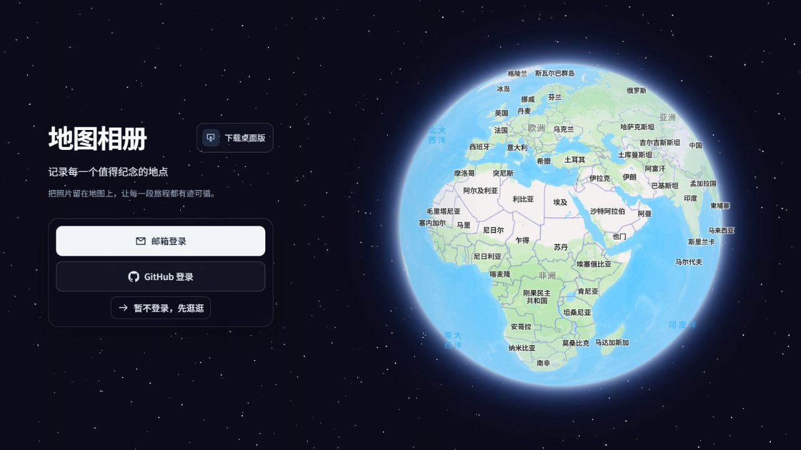
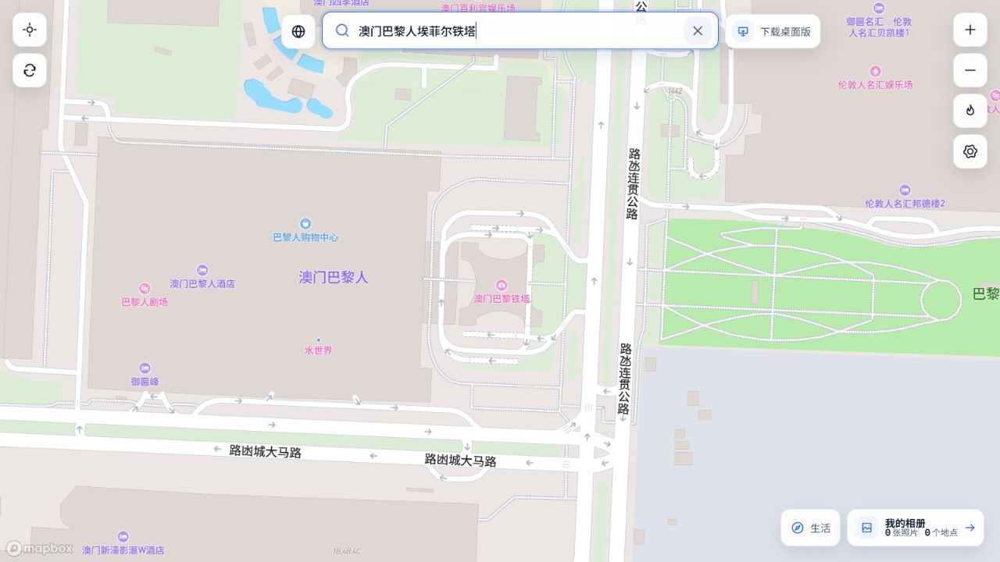

# PhotoMap: A Photo Album on the Map

Keep your photos on the map, so every journey leaves a trace.

[简体中文](./README.zh-CN.md) · [Open PhotoMap on the web](https://photomap.satula.top) · [Latest Release](https://github.com/Satulalala/photo-map/releases/latest)

PhotoMap is a photo-mapping app built with React, Electron, and Mapbox. Add places to a map, upload photos, write notes, and revisit your records through albums, search, and travel history. The project provides both desktop and web versions.

## Screenshots

<p align="center">
  
  
</p>

The screenshots show public-facing screens and contain no personal photos or private locations.

## Download the Desktop App

[Download the Windows x64 installer for v1.3.4](https://github.com/Satulalala/photo-map/releases/download/v1.3.4/PhotoMap-1.3.4-win-x64-setup.exe). This release fixes thumbnails that turned gray in location popups and on album covers after a preview was closed.

Download the latest release from [GitHub Releases](https://github.com/Satulalala/photo-map/releases/latest). Windows provides an x64 installer; macOS provides packages for Intel and Apple silicon; Linux provides AppImage, deb, and rpm packages. GitHub Actions injects the map access token into desktop packages for each platform through the repository Secret `MAPBOX_TOKEN`. The map cannot load without it. The macOS version is currently unsigned, so you may need to allow it manually in System Settings the first time you open it.

## Features

- **Map and places:** A rotatable globe entry screen, Chinese map labels, place search, geolocation, zoom, markers, and a photo heatmap.
- **Photos and notes:** Associate multiple photos with a place; preview, rotate, and crop photos; edit notes; and manage items in batches.
- **My Album:** View photo and place counts, jump to a shooting location from the marker list, and open its details.
- **Travel history:** Organize existing place records by regions in China and by country elsewhere.
- **Semantic search:** Currently unavailable. The app does not download or load a local embedding model; a server-side model service may be evaluated later.
- **Accounts and sync:** After signing in, places, photo notes, and photo files sync by account. Photos are stored in R2 and metadata in D1; desktop and web clients share the same cloud data.
- **Interface and interaction:** Light, dark, and system themes; responsive overlays; keyboard support; and reduced-motion support.

The map prioritizes Chinese labels. Places without Chinese names may still appear in their local language. The map uses the device location or a default coordinate when opened. Dragging the globe on the sign-in page is for browsing and does not change the map's location target.

## Desktop and Web Versions

| Capability | Desktop | Web |
| --- | --- | --- |
| Map, markers, photos, and notes | Supported | Supported |
| Local storage | SQLite and local photo files | Browser IndexedDB |
| Rotate and crop photos | Supported | Supported |
| Search place names and note text | Supported | Supported |
| Semantic search | Not available; no model is loaded | Not available |
| Cloud sync | Sign in to sync through Cloudflare Worker + D1/R2 | Sign in to sync through Cloudflare Worker + D1/R2 |

The desktop version keeps its SQLite database and photo files on the device. The web version uses browser IndexedDB. After sign-in, places and notes sync to D1, while originals and thumbnails are uploaded to R2 and isolated by account. Guest data is not uploaded automatically; you can import it into a signed-in account in Settings. The default service is `https://photomap.satula.top`. Choose “Not now” at sign-in to continue using the local album.

## MapLibre Test Version

During local web development, open `http://localhost:3001/maplibre-test`. This route continues to use PhotoMap's existing sign-in, session, page layout, album data, and map business components; only the map rendering engine switches to MapLibre. The production home page still uses Mapbox. The Cloudflare Worker has an SPA fallback, so `/maplibre-test` can also be opened directly when this version is included in a deployment. Current changes do not deploy to production automatically.

The test page reads places and photos from the existing browser IndexedDB. To keep test content out of the real album, IndexedDB write transactions for places, photos, and settings are intercepted, and the cloud sync queue plus cloud push/pull are disabled on this route. Authentication still uses the existing account and session. The page displays a “MapLibre Test · Read-only Data” label.

The default basemap uses the OpenFreeMap Liberty global vector style (OpenStreetMap data) and requires no API key. You can replace it with a MapLibre style service that fits the project's use and licensing terms through `VITE_MAPLIBRE_STYLE_URL` in `.env`. Place search still reuses the existing Amap / Mapbox geocoding APIs. MapLibre uses a transparent sky, CSS stars, and GL JS atmosphere styling to approximate the starry edge of the production map. It cannot fully reproduce Mapbox-only `fog`, `space-color`, and `star-intensity` effects.

## Tech Stack

| Area | Current implementation |
| --- | --- |
| Frontend | React 18, Vite 8, Zustand, CSS |
| Desktop runtime | Electron 44, IPC |
| Maps | Mapbox GL JS 3.32.0 (production); MapLibre GL JS 6.13.0 (read-only test version) |
| Desktop data and image processing | better-sqlite3, sqlite-vec, Sharp |
| Semantic search | Currently disabled; the desktop app does not download or load a model, and related dependencies are retained for later evaluation |
| Web data | IndexedDB, LocalStorage |
| Backend | Web production: Cloudflare Workers + D1; desktop/local: Java 17+, Spring Boot 3.5, JWT, Spring Data JPA |
| Verification tools | Vitest, Testing Library, Playwright, ESLint, TypeScript |

See [package.json](package.json), [package-lock.json](package-lock.json), and the [backend pom.xml](server-java/pom.xml) for exact dependency versions.

## Run Locally

Run the following commands from the project root unless noted otherwise.

### 1. Prepare the Environment

- Node.js: **22.23.2**, as specified by [.nvmrc](.nvmrc), is recommended. See `engines` in `package.json` for other supported versions.
- npm: version 10 or later.
- Optional Java backend: JDK 17+ and Maven 3.6.3+. The local map and album do not require the backend; email sign-in and sync do.

```bash
npm ci
npm run env:check
```

Installation downloads Electron and checks native modules for the desktop runtime. For web-only development, you can use `npm ci --ignore-scripts`. Before switching to desktop development, run `npm rebuild` and `npm run native:check`.

### 2. Configure a Map Token

Copy [.env.example](.env.example) to `.env` and enter your own public Mapbox access token. Do not overwrite an existing `.env`:

```dotenv
VITE_MAPBOX_TOKEN=your_public_Mapbox_access_token
```

Create a token on the [Mapbox account page](https://account.mapbox.com/access-tokens/). Frontend environment variables are included in browser code, so use a public token here. Restart the development server after changing it. Set the variable in the build environment when publishing.

### 3. Start the App

Desktop:

```bash
npm run dev
```

Web:

```bash
npm run web:dev
```

| Service | Default address |
| --- | --- |
| Desktop Vite development server | `http://localhost:3000` |
| Web version | `http://localhost:3001` |
| Java backend | `http://localhost:8080` |

On the first desktop launch, the app loads the image-search model; download time depends on the network. Until the model is ready, description search displays a loading message. The first search also creates any missing photo indexes.

### 4. Start the Backend (Optional)

On Windows, use the project scripts to avoid errors when `mvn` is not directly available:

```powershell
npm run server:dev
npm run server:verify
```

The scripts first check `JAVA_HOME` and Maven on PATH, then look for an installed Windows JDK and IntelliJ's bundled Maven. If neither is found, install JDK / Maven and configure the environment variables.

On Linux / macOS, or in an environment where Maven is configured:

```bash
mvn -f server-java/pom.xml spring-boot:run
mvn -f server-java/pom.xml verify
```

Development uses an H2 in-memory database. Production uses PostgreSQL and requires these variables in the backend process environment:

```text
SPRING_PROFILES_ACTIVE=prod
PHOTOMAP_DB_URL
PHOTOMAP_DB_USERNAME
PHOTOMAP_DB_PASSWORD
PHOTOMAP_JWT_SECRET
PHOTOMAP_CORS_ALLOWED_ORIGINS
```

Example values are in `.env.example`. The root `.env` is used for frontend builds and is not automatically passed to the Java backend. Production validates the database schema by default and does not create business tables automatically.

### Deploy to Cloudflare

The current live site is [photomap.satula.top](https://photomap.satula.top), with a health check at `/api/health`. One Cloudflare Worker serves both the `dist-web` static files and the `/api/v1` authentication and `/api/v2` sync APIs. D1 persistently stores accounts and sync metadata; R2 stores originals and thumbnails isolated by account.

The web version uses same-origin HttpOnly cookies. The packaged desktop app accesses the Cloudflare API through the fixed secure origin `photomap://app`. The Worker allows credentialed CORS only for this desktop origin and sets a 24-hour `HttpOnly; Secure; SameSite=None` session cookie. The desktop app keeps local photos and SQLite data while syncing signed-in account data to the cloud. Never put `JWT_SECRET` or a Cloudflare API token in frontend configuration.

1. Log in with the Cloudflare CLI and create a D1 database for your deployment:

   ```bash
   npx wrangler login
   npx wrangler d1 create photo-map-prod
   ```

   Put the returned database ID and name in `wrangler.jsonc`. The repository configuration points to the account currently used by the project; for your own account, replace the D1 ID and the `routes` domain.

2. Apply the D1 schema to the remote database:

   ```bash
   npm run cloudflare:migrate
   ```

3. Connect the `Satulalala/photo-map` repository in Cloudflare Workers Builds, set the production branch to `master`, and configure the public Mapbox access token as the build variable `VITE_MAPBOX_TOKEN`. Use `npm ci --ignore-scripts && npm run cloudflare:build` as the build command and `npm run cloudflare:deploy` as the deploy command. If preview deployments are enabled, configure a separate D1 database and domain for the preview environment.

4. Under Worker **Settings → Variables and Secrets**, set `JWT_SECRET` to a randomly generated secret of at least 32 bytes. You can also run `npx wrangler secret put JWT_SECRET`. Do not put this secret in Git, `.env`, or ordinary Wrangler variables. Without it, the API returns 503 and does not create incomplete accounts.

5. Create a GitHub OAuth App and set its callback URL to `https://photomap.satula.top/api/v1/auth/github/callback`. Add `GITHUB_CLIENT_ID` and `GITHUB_CLIENT_SECRET` as Worker Secrets. OAuth requests access only to GitHub profile information and verified email.

6. In the Hong Kong region (`ap-hongkong`) of Tencent Cloud SES, verify the sending domain `mail.photomap.satula.top`, create the sender address `no-reply@mail.photomap.satula.top`, and upload `cloudflare/password-reset-template.html`. Keep the fixed domain `https://photomap.satula.top/` in the template. The only variable, `{{resetToken}}`, must contain the reset token alone; do not make the whole URL a variable. Add `TENCENT_SECRET_ID`, `TENCENT_SECRET_KEY`, and `TENCENT_SES_TEMPLATE_ID` as Worker Secrets. Use CAM sub-user credentials with email-sending permission only. After template approval and sender verification, set `AUTH_EMAIL_ENABLED` to `"true"` in `wrangler.jsonc` and deploy. Password reset tokens are stored only as hashes, expire after 30 minutes, and invalidate old sessions when used.

7. Check `https://<domain>/api/health` and confirm that `ok` and `authReady` are `true`, then bind the custom domain route to the Worker. After changing the D1 schema, run `npm run cloudflare:migrate` before deploying the Worker.

Worker sign-in uses PBKDF2-SHA256 with 100,000 iterations, preceded by HMAC-SHA256 using `PASSWORD_PEPPER` stored only in Worker Secrets. Cloudflare's production Web Crypto runtime caps PBKDF2 at 100,000 iterations. Do not rotate the pepper after passwords have been created, or existing passwords can no longer be verified. Before deployment, use `wrangler secret put PASSWORD_PEPPER` to set a random value of at least 32 bytes. Monitor production CPU usage. If the Worker hits the 1102 resource limit, evaluate Workers Paid or another suitable approach; do not silently weaken authentication. See [Cloudflare Workers limits](https://developers.cloudflare.com/workers/platform/limits/).

To run the Cloudflare Worker locally with local D1, use `npm run cloudflare:dev` after setting a local `JWT_SECRET` in the ignored `.dev.vars` file. General web development can still use `npm run web:dev`, which proxies `/api` to the local Java service.

## Build and Verification

Choose commands based on the scope of the change. Documentation-only changes do not require rebuilding the app.

```bash
npm run lint
npm run type-check
npm test
node --test electron/ipc-handlers/ai-handlers.test.cjs
npm run test:e2e
npm run build          # desktop frontend; output in build/
npm run web:build      # web; output in dist-web/
npm run dist -- --win --x64 --publish never # Windows x64 installer
npm run dist           # build a desktop package for the current OS
```

Pushing a `v*` version tag triggers `.github/workflows/build-release.yml`, which builds desktop packages on Windows, macOS, and Linux and creates a GitHub Release. The Windows installer filename ends in `-setup.exe`.

On Windows, Playwright prefers the installed Edge browser. In other environments, run `npx playwright install chromium`, or specify a browser with `PLAYWRIGHT_CHANNEL`. UI tests isolate external map APIs; loading the real basemap still requires a valid token and network access.

## Directory Structure

```text
PhotoMap/
├─ electron/              # desktop main process, SQLite, IPC, and image search
├─ src/
│  ├─ api/                # shared APIs, browser storage, and sync
│  ├─ components/         # map, album, travel, and settings UI
│  ├─ hooks/              # map, sign-in, search, and interaction logic
│  ├─ store/              # Zustand state
│  └─ styles/             # component styles and layout
├─ src-web/               # web entry point and adapters
├─ server-java/           # Spring Boot backend
├─ scripts/               # startup, environment checks, and UI screenshots
├─ e2e/                   # Playwright UI tests
├─ .github/workflows/     # automated builds and release configuration
├─ AGENTS.md              # project collaboration guidelines
└─ .env.example           # environment variable examples
```

## Current Limitations

- Semantic search is disabled. The desktop app does not download or load an embedding model; searches for place names and note text remain available.
- Cloudflare sync uploads places and notes plus other metadata to D1, and uploads originals and thumbnails to R2. Each account has a 5 GiB cloud storage quota. Existing guest data must be imported into an account manually.
- The backend `/api/v1/ai/search`, `ask`, and `summarize` endpoints use text matching, rules, and statistics; they are not connected to a large language model. Semantic photo search is currently disabled.
- Cloudflare web deployment serves the API and page on the same domain. Before going live, create D1 and configure `JWT_SECRET` and a public Mapbox token. Existing Java/PostgreSQL accounts are not migrated automatically to the new D1 database.
- The map uses Mapbox data and network services; loading speed and data freshness depend on the service and connection. The app currently uses native viewport caching and preloads before entering the map; it does not provide full offline maps.
- Local photos, databases, model caches, personal permission settings, and test screenshots are not committed to Git. The project screenshots in this README contain no personal data. The web local copy is stored with browser site data; clearing that data affects the local album.

## License

[MIT](LICENSE)
